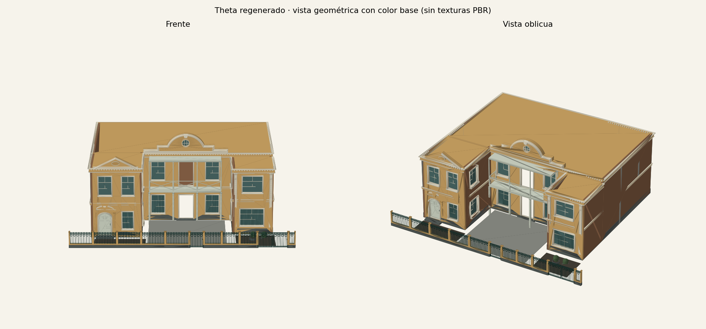

# Casa de demostración: de theta a geometría

Solicitud analizada: [casa_demostracion_barranco/request.json](../../steps/step23_fresh_theta/casa_demostracion_barranco/request.json). Su receta Python está en `showcase()` de [generar_frontones.py](../../steps/step23_fresh_theta/generar_frontones.py).

Se regeneró la solicitud original con `pipeline.theta.reconstruct`. **Los conteos y el hash de posiciones + caras coinciden con el manifiesto original.** Es una composición de demostración, no una reconstrucción inferida de fotografías.



Vista geométrica de Matplotlib con color base y sombreado simple: no simula texturas PBR ni transparencia. Sirve para revisar silueta, disposición y proporciones; el GLB permite inspeccionar materiales y piezas en un visor 3D.

## 1. Parcela, masas y niveles

La parcela mide **24 × 24 m**. El frente 0 está en Y=0, de X=0 a X=24; la calle queda hacia −Y. La solicitud pide `schema_version="0.3"`, `massing.pattern="explicit"`, `family="republicano"` y `architectural_style="republicano"`.

Aquí familia y estilo comparten nombre, pero son controles distintos. El programa de vanos es explícito, así que no se obtiene automáticamente del ritmo de la familia.

| Masa resuelta | Huella XY | Niveles (m) | Lectura visual |
|---|---|---|---|
| `principal:0` | X=3–21; Y=8–19 | `[0, 3.6, 7.2]` | Cuerpo ancho al fondo, con frente central hacia el patio. |
| `izquierda:0` | X=3–8; Y=3–8 | `[0, 3.6, 7.2]` | Ala adelantada de 5 × 5 m, con puerta arqueada y frontón triangular. |
| `derecha:0` | X=17–21; Y=4–8 | `[0, 3.6, 6.8]` | Ala de 4 × 4 m, más baja y menos adelantada, con pilastras. |

El resolver deriva `height_m=7.2` y `floors=2`. El segundo nivel del ala derecha mide 3.2 m, frente a 3.6 m en las otras masas. Esto ilustra por qué los niveles explícitos son más expresivos que una sola altura de piso.

Se resuelven **10 paredes**, en lugar de las 12 aristas iniciales: las traseras de las alas quedan ocultas por el cuerpo principal. En el frente del principal se conserva aproximadamente el tramo u=5–14 hasta Z=6.8, y u=5–18 entre Z=6.8 y Z=7.2. El ritmo y las coordenadas siguen referidos a la arista original de 18 m.

## 2. Las 16 aberturas

La fachada global es explícita y vacía. Cinco overrides activan los vanos deseados; las demás caras quedan ciegas.

| Cara | Planta baja | Planta alta | Total |
|---|---|---|---:|
| `principal:0`, arista 0 | Dos ventanas con reja y puerta central de dos hojas vidriadas | Dos ventanas y puerta a la galería | 6 |
| `izquierda:0`, arista 0 | Puerta arqueada panelada con portal de pilastras y ventana enrejada | Dos ventanas rectangulares | 4 |
| `derecha:0`, arista 0 | Ventana ancha con reja | Ventana rectangular | 2 |
| `izquierda:0`, arista 1 | Ventana hacia el patio | Ventana hacia el patio | 2 |
| `derecha:0`, arista 3 | Ventana hacia el patio | Ventana hacia el patio | 2 |

Resultado: **13 ventanas y 3 puertas**. El óculo del frontón se construye dentro de ese ensamble y no pertenece a este conteo de aberturas de pared.

Las ventanas tienen receso de 0.15 m, ancho de marco de 0.10 m y profundidad de marco de 0.12 m. `frame_profile="auto"` selecciona el perfil republicano por el estilo global; montantes y alféizares producen el relieve claro alrededor del vidrio verdoso. Las tres puertas incluyen el bloque `door`, necesario para obtener hojas y herrajes del constructor detallado.

Ejemplo de coordenadas: la ventana principal en `(u_m=5.8, v_m=0.7)` comienza en X=8.8, Y=8, Z=0.7. No comienza en X=5.8: u se mide desde el inicio de la arista de la masa, X=3.

## 3. Galería y miembros verticales

`galeria_blanca` se ancla al principal, arista 0, a **Z=3.6 m**. Ocupa u=5.7–12.9, tiene 7.2 m de ancho y 1.3 m de profundidad hacia el patio.

- `kind="gallery"`, `variant="turned_gallery"`, cubierta habilitada y altura de cierre de 3.15 m.
- Plataforma de madera; baranda de cruces, también de madera, de 1 m de altura.
- Columnas anidadas con `style="madera"`, `variant="saddle_post"`: postes con zapata superior. Este diseño local convive con el estilo global republicano.
- Cuatro postes independientes debajo, a u=5.7, 8.1, 10.5 y 12.9; sección de 0.18 × 0.18 m, altura de 3.42 m y separación de la pared de 1.3 m.
- Dos pilastras independientes `recessed_panel` flanquean el ala derecha, desde Z=0.55 hasta Z=6.32; sección nominal de 0.30 × 0.14 m.

Hay **6 miembros independientes** en `vertical_members`, pero el perfil registra **14 llamadas a `build_member`**: el constructor también sirve a los miembros anidados de galería y portal. No confundir el número de entradas JSON con el de piezas materializadas.

## 4. Frontones, bandas y techo

| Ensamble | Decisión de entrada | Resolución y aspecto |
|---|---|---|
| `fronton_central` | `silhouette="mixed"`, `stepped=true`; 8.5 × 2 m | Clasificado como `stepped_segmental`: hombros escalonados y centro curvo, clave y óculo real de 0.7 m. |
| `fronton_ala` | `family="triangular"`; 4.4 × 1.1 m | Triángulo moldurado sobre el ala izquierda, con cartela. |
| `sobrepuerta` | `family="segmental"`; 2.25 × 0.48 m; `anchor="opening_top"` | Arco rebajado sobre la puerta izquierda, con clave; usa `opening_index=0` y separación `base_m=0.23`. |

El central demuestra la clasificación por atributos; los otros dos fuerzan una familia explícita. Las razones de clasificación quedan en el resultado resuelto.

Dos entablamentos recorren los bordes expuestos:

- `coronacion`: 0.48 m de altura, vuelo de 0.23 m y dentículos, siguiendo las cotas superiores de las masas.
- `cinturon`: coronación absoluta en Z=3.6, altura de 0.24 m y vuelo de 0.12 m.

La cornisa automática de `trim` está deshabilitada para esta composición; el zócalo usa juntas horizontales, altura de 0.55 m y relieve de 0.025 m. Entablamentos y zócalos se expanden en **359 registros de trim**, incluyendo detalle repetido; no son 359 decisiones manuales.

Hay **tres superficies de techo plano**, sin parapeto ni props. Los frontones superan la altura de las masas sin crear un tercer piso ni una habitación detrás. No se solicitan `roof_assemblies` ni `roof_bodies`.

## 5. Cerco, patio y materiales

El cerco se escribe como un tramo explícito sobre la arista 0 de la parcela, de 1 a 23 m: estilo republicano, altura de 1.65 m, base de 0.4 m y zócalo escalonado de piedra. Incluye puerta peatonal de 1.4 m y portón de 3 m. `site.fence="none"` desactiva el cerco automático, pero no borra `site.runs`.

Hay dos zonas `garden` y una `patio`, definidas relativamente al frente; el resolver añade el sobrante `free:0`, de tipo `unclassified`. Del mismo modo, `garden=false` no borra las zonas de jardín declaradas explícitamente.

La paleta solicitada combina muro ocre (`primary_color=[0.86,0.69,0.42]`), marcos/cornisas crema, madera pintada clara, metal verde oscuro, piedra gris y vidrio verdoso. Los ocho overrides son para `frame`, `cornice`, `wood`, `metal`, `stone`, `plinth`, `glass` y `roof`. Un slot coloreado no determina por sí solo la forma de una pieza ni garantiza que todas las superficies de apariencia similar usen ese slot.

## 6. Flujo medido

El perfil comprende solo la llamada a `reconstruct`, después de decodificar el JSON. Registró ejecución en **44 módulos de `src/`**; la validación posterior, exportación y preview quedan fuera de ese perfil.

| Función | Llamadas | Tiempo acumulado (s) |
|---|---:|---:|
| `pipeline.theta.reconstruct` | 1 | 10.443 |
| `modeling.theta.resolve_theta` | 1 | 0.490 |
| `modeling.theta.generate_resolved` | 1 | 9.892 |
| `fences.build_fence` | 1 | 3.360 |
| `grammar.facade` | 10 | 2.846 |
| `vertical_member_assembly.build_member` | 14 | 1.731 |
| `window_assembly.build_window` | 13 | 1.666 |
| `door_assembly.build_door` | 3 | 1.023 |
| `trim_resolver.emit_trims` | 1 | 0.947 |
| `balcony_assembly.build_balcony` | 1 | 0.818 |
| `crown_assembly.build_crown` | 3 | 0.750 |

Los tiempos incluyen llamadas hijas y **no se suman entre filas**. Son una observación instrumentada con cProfile, no un benchmark de latencia sin instrumentación. Una reproducción anterior tardó 9.792 s y produjo los mismos conteos y hash.

## 7. Resultado y diagnóstico

| Métrica | Resultado |
|---|---:|
| Vértices | 58 674 |
| Triángulos | 108 504 |
| Partes / registros de componente | 2 677 |
| Validación de envolvente | Pasa |
| Violaciones topológicas | 4 |
| Bordes abiertos totales | 0 |
| Aristas no-manifold totales | 0 |

Las cuatro violaciones corresponden a `window_grille`: el analizador espera conectividad única por registro, pero encuentra barras desconectadas agrupadas dentro de él.

| Pared y posición de abertura | Componentes conectados dentro del registro |
|---|---:|
| `derecha:0/edge0`, u=0.65, v=0.80 | 16 |
| `izquierda:0/edge0`, u=3.00, v=0.80 | 7 |
| `principal:0/edge0`, u=5.80, v=0.70 | 9 |
| `principal:0/edge0`, u=11.30, v=0.70 | 9 |

En esos registros no hay bordes abiertos, aristas no-manifold, orientación incoherente, caras duplicadas ni degeneradas. El resultado **no pasa limpiamente el contrato topológico por componente**, aunque sí pasa la envolvente. Esto debe distinguirse de una fuga del muro o una abertura mal perforada.

Identidad de la reproducción (`grammar-v1.1-dev`):

```text
SHA-256 solicitud:
3b5d40f351f3dd5d47ac5d87e1adc9c1f759e25ba6ba27fdab67c9f03fef1d5c

SHA-256 bytes de posiciones + caras:
8d61ddb05789c4f3e9ec26fca6fa3255c957b36456bc30d67a7af32837291880
```

El segundo hash verifica geometría y orden de arrays; no es un hash del GLB, de sus materiales ni de las imágenes PBR.

## 8. Reproducir y aplicar el aprendizaje

Desde la raíz del repositorio, elegir una carpeta de salida nueva:

```bash
python3 house_grammar/docs/guia_theta/revisar_theta.py \
  house_grammar/steps/step23_fresh_theta/casa_demostracion_barranco/request.json \
  --output /tmp/opencode/mi-demo-theta --preview
```

Se obtienen `request.json`, `resolved_theta.json`, `validation.json`, `topology_summary.json`, `calls.json`, `summary.json`, `building.glb` y `preview.png`. La ejecución usada para este análisis está en `/tmp/opencode/theta-review-documentada`; la imagen de esta página conserva una copia de su preview.

Para autoría, seguir el mismo orden: **masas y niveles → caras y vanos → piezas ancladas → materiales → validación y vista**. Los IDs del resultado resuelto sirven para anclar; las razones de completado/clasificación permiten auditar decisiones. El [prompt](PROMPT.md) convierte este recorrido en instrucciones reutilizables.
